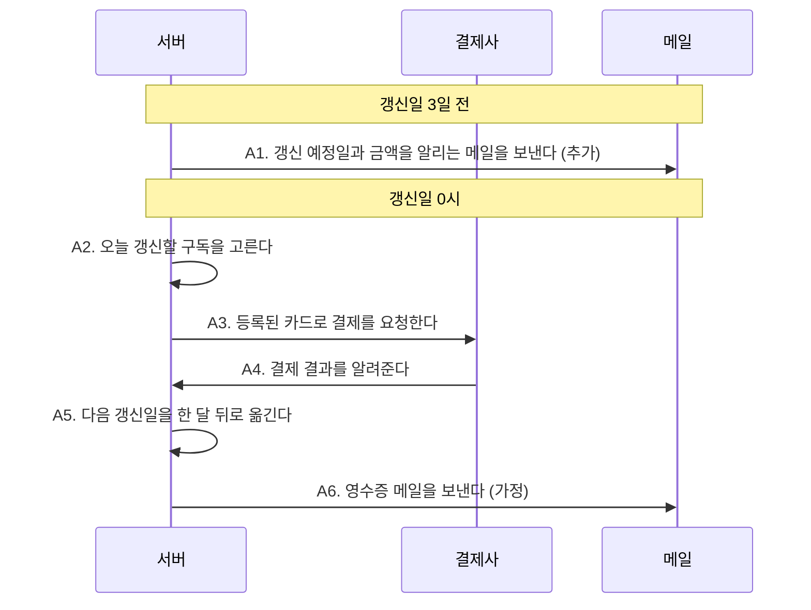
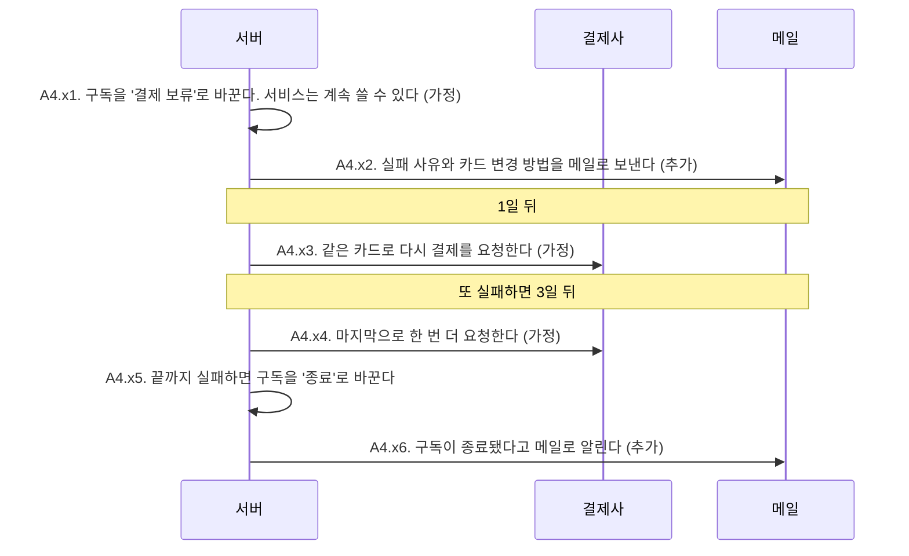
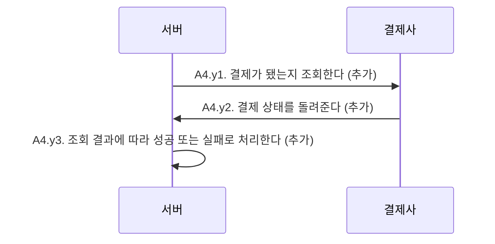
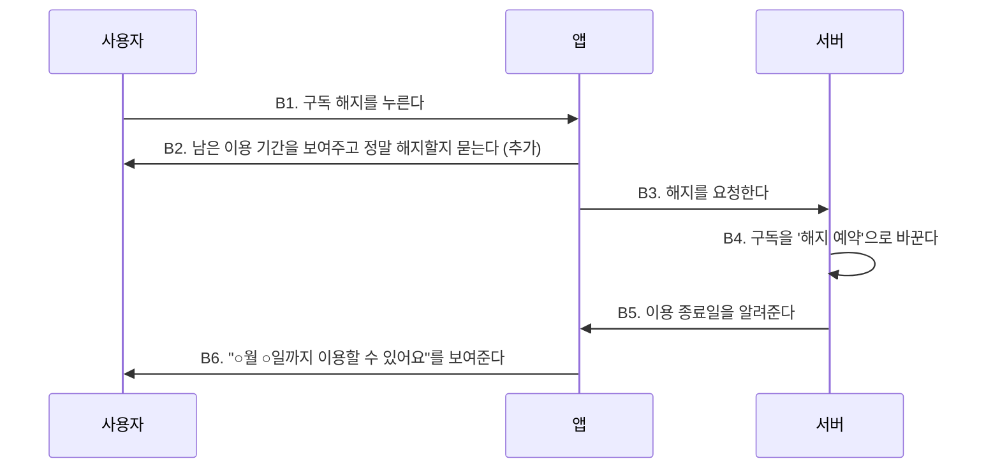
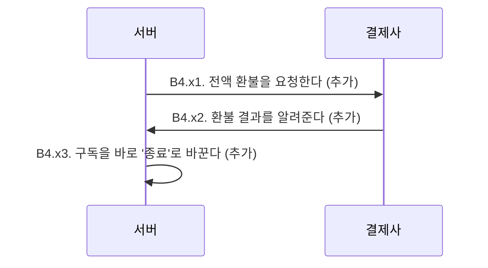
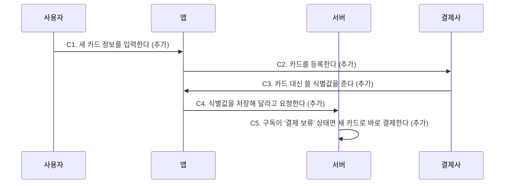

# 구독 자동 갱신과 해지

- 상태: 작성 중
- 요청: "월 구독을 자동으로 갱신하고, 결제가 실패하면 재시도하고, 사용자가 해지할 수 있게 해줘"

## 먼저 확인할 것

AI가 가정하거나 추가한 것을 한곳에 모았다.

| ID | 내용 | 출처 |
|---|---|---|
| A1 | 갱신 3일 전에 예정일과 금액을 메일로 알린다 | 추가 |
| A2.c | 같은 구독은 하루에 한 번만 결제한다 | 가정 |
| A5.a | 31일에 시작한 구독은 짧은 달에는 말일에 갱신한다 | 가정 |
| A6 | 결제가 되면 영수증 메일을 보낸다 | 가정 |
| A4.x1 | 결제가 실패해도 재시도하는 동안은 서비스를 계속 쓸 수 있다 | 가정 |
| A4.x2, A4.x6 | 실패했을 때와 종료됐을 때 메일로 알린다 | 추가 |
| A4.x3, A4.x4 | 재시도는 1일 뒤와 3일 뒤, 두 번 한다 | 가정 |
| A4.y | 결제 결과가 10분 안에 오지 않으면 직접 조회한다 | 추가 |
| B2 | 해지하기 전에 남은 기간을 보여주고 한 번 더 묻는다 | 추가 |
| B4.a, B4.b | 해지해도 결제한 기간 끝까지 쓰고, 환불은 하지 않는다 | 가정 |
| B4.x | 결제 7일 이내이고 사용한 적이 없으면 전액 환불한다 | 추가 |
| C | 흐름 전체: 사용자가 결제 카드를 바꾼다 | 추가 |

## 흐름 A. 갱신일이 되면 자동으로 결제한다

15줄 · 추가 6 · 가정 6

**규칙**

- A2.a 상태가 '이용 중'인 구독만 고른다
- A2.b 해지 예약된 구독은 결제하지 않고 '종료'로 바꾼다
- A2.c 같은 구독은 하루에 한 번만 결제한다 (가정)
- A5.a 31일에 시작한 구독은 짧은 달에는 말일에 갱신한다 (가정)

**이럴 땐**

A4.x 결제가 실패하면 · 6줄 · 추가 2 · 가정 3

A4.y 결과가 10분 안에 오지 않으면 (추가) · 3줄 · 추가 3

## 흐름 B. 사용자가 구독을 해지한다

9줄 · 추가 4 · 가정 2

**규칙**

- B4.a 이미 결제한 기간이 끝날 때까지는 그대로 이용한다 (가정)
- B4.b 남은 기간에 대한 환불은 하지 않는다 (가정)

**이럴 땐**

B4.x 결제한 지 7일 이내이고 사용한 적이 없으면 (추가) · 3줄 · 추가 3

## 흐름 C. 사용자가 결제 카드를 바꾼다 (추가)

5줄 · 추가 6

**규칙**

- C2.a 카드 번호는 우리 서버를 거치지 않는다 (추가)

## 완료 기준

- 갱신일이 지난 구독의 다음 갱신일이 한 달 뒤로 바뀌어 있고, 결제 내역이 한 건 생긴다
- 결제가 두 번의 재시도까지 모두 실패한 구독은 '종료' 상태가 된다
- 해지한 사용자는 결제한 기간이 끝나는 날까지 서비스를 쓸 수 있고, 그 뒤로는 결제되지 않는다

## 제외한 것

- 연 단위 구독과 요금제 변경: 요청이 월 구독만 말했다
- 쿠폰과 할인: 요청에 없다
- 해지 예약을 취소하고 다시 구독하기: 요청에 없고, 필요하면 따로 정한다
