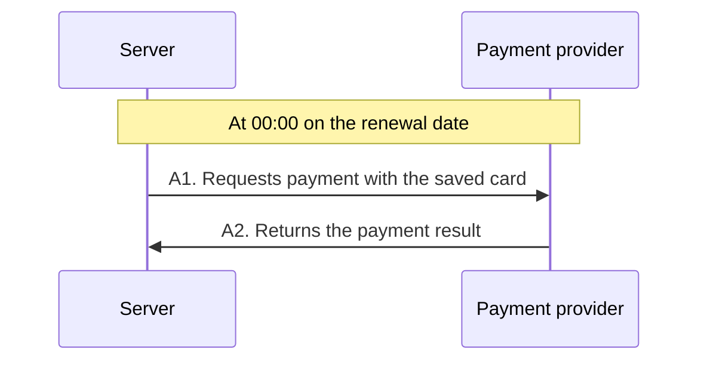
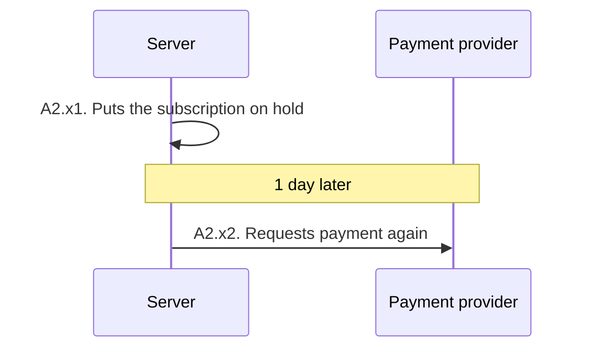

# unfold

Write what the feature does as sequence diagrams, fix it with the user in chat, and implement only what they confirm. No design or code before confirmation.

## Rules

- **File**: `specs/<feature-slug>/scope.md`, unless the project's instruction file names another place. Write in the user's language, including the template labels.
- **Line**: one arrow, one sentence saying what the sender does, with concrete values ("issues a presigned URL valid for 15 minutes"). A category name like "Validation" is not a line; what gets checked goes in that line's rules.
- **Scope, not design**: participants are users, our system (at most app and server), and external systems, five at most. Never name our own classes, functions, tables, or files. Technical terms the team uses (presigned URL, webhook) are fine.
- **Origin**: mark `(assumed)` when you picked a value or detail the user did not state, `(added)` when the user did not ask for it at all. If you cannot point to the words in the request, it is one of the two.
- **IDs**: flow `A`, line `A1`, rule `A1.a`, exception `A1.x`, line in an exception `A1.x1`. The user refers to them in chat, so never renumber or reuse one.
- **Diagrams**: the main diagram shows only the normal path, about 5 to 10 lines. No `alt`, `opt`, or `loop`; each branch is an exception in its own `<details>`. Use `Note over` for time gaps. No `autonumber`, and no semicolons or `#` in message text.

## Template

````markdown
# <Feature name>

- Status: draft
- Request: "<quoted as given>"

## Check these first

| ID | What | Origin |
|---|---|---|
| A2.a | The same subscription is charged at most once a day | assumed |

## Flow A. <what starts it and what it achieves>

4 lines · 1 assumed



**Rules**

- A2.a The same subscription is charged at most once a day (assumed)

**Exceptions**

<details>
<summary>A2.x When the payment fails · 2 lines</summary>



</details>

## Done when

- <an observable result>

## Left out

- <considered but not included>: <why>
````

One flow per starting point. "Check these first" lists every assumed and added item. Counts cover everything inside the flow or exception.

## Steps

1. Read only what you need. Ask only if you cannot write the main flow without the answer; otherwise decide and mark it assumed.
2. Write the whole document. Check origins, counts, and that every main diagram reads top to bottom on its own.
3. Tell the user the file path and the assumed and added IDs. Do not paste the document into chat.
4. Apply chat feedback in one pass and reply with the IDs you changed. An accepted item loses its mark; a dropped item moves to "Left out" if worth remembering.
5. Confirm only when the user says so. First list every item still marked added and ask keep or drop. Then set `Status: confirmed (<date>)`.

After confirmation, build only what the document says. If something else seems needed, stop and ask; never edit a confirmed document on your own.
